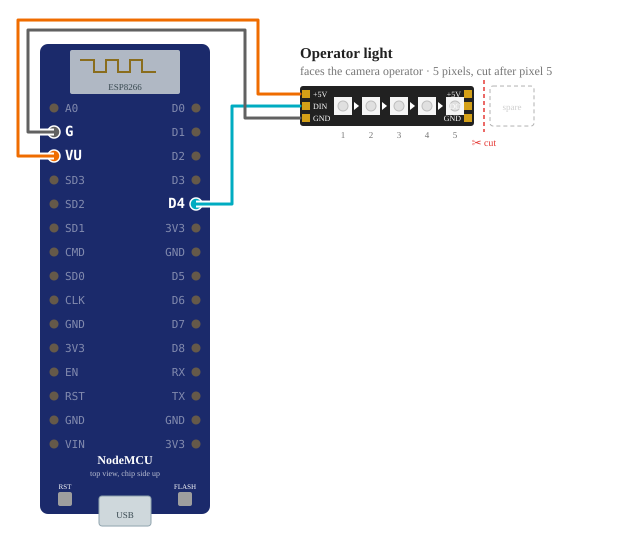
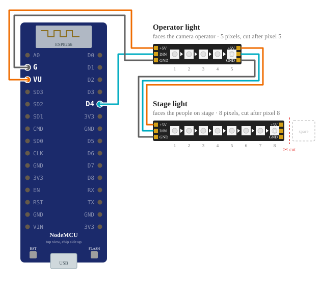
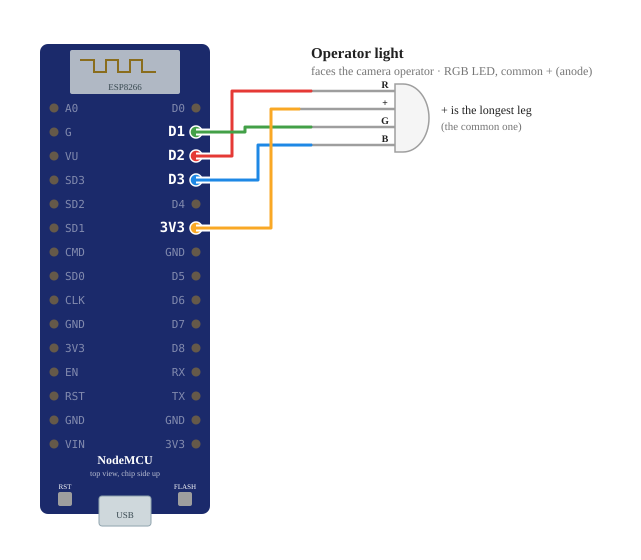

# Wiring a light

Generated from the hub's own wiring code (`hub/scripts/wiring-docs.ts`), the same that draws the diagram in
Build a light, step 1. Pick your parts there and the page shows exactly your wires; these are the common builds.

The board is a NodeMCU v3 (LoLin), seen from above with the antenna at the top and the USB socket at the bottom.
A strip's +5V comes from **VU** (the 5 V of the USB socket); VIN carries nothing on these boards while they run
from USB. Its GND goes to the **G** right next to VU. Boards that print RSV there instead (Amica) use VIN and a GND pin.

## A NeoPixel strip as the operator light (the usual build)

Five WS2812 pixels on D4, powered from VU. No stage light.

| Board pin | Goes to |
|---|---|
| D4 | DIN pad of the operator strip (data in, the end the arrows point away from). Its first 5 pixels are the operator light. |
| VU | +5V pad of the operator strip. Not 3V3. A board without VU and G there (Amica: RSV) uses VIN and a GND pin instead. |
| G | GND pad of the operator strip (G is a GND pin) |

## Two strips: operator and stage

The stage strip is chained to the end of the operator strip, not wired to the board.

| Board pin | Goes to |
|---|---|
| D4 | DIN pad of the operator strip (data in, the end the arrows point away from). Its first 5 pixels are the operator light. |
| VU | +5V pad of the operator strip. Not 3V3. A board without VU and G there (Amica: RSV) uses VIN and a GND pin instead. |
| G | GND pad of the operator strip (G is a GND pin) |
| operator strip DOUT | DIN pad of the stage strip (8 pixels). Not to the board. |
| operator strip +5V | +5V pad of the stage strip |
| operator strip GND | GND pad of the stage strip |

## A single RGB LED as the operator light

A common-anode (common +) RGB LED on D1, D2, D3. For a common-cathode LED the common leg goes to GND instead.

| Board pin | Goes to |
|---|---|
| D2 | red leg |
| D1 | green leg |
| D3 | blue leg |
| 3V3 | common + leg (the longest leg) |

## Checking it

Build a light, step 3 lights each colour through the USB cable and asks what you see, and tells you which wire to
move. The strip stays dark? Check +5V is on VU, not 3V3 or VIN. One colour wrong? The strip's colour order is set
in step 1 (GRB is the usual).
